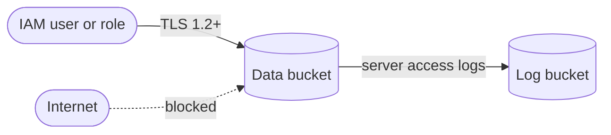

# AWS Secure Object Storage (S3)

A private S3 bucket with a separate log bucket. No website, no CDN, no network: access is controlled by IAM.

OpenTofu demo template. Standalone, no dependency on other repos. Compatible with Terraform.

## Architecture



- Data bucket: public access block (all four settings), ACLs off (`BucketOwnerEnforced`), SSE-S3 (SSE-KMS optional), versioning, lifecycle rule for old versions
- Bucket policies (both buckets): deny requests without TLS and below TLS 1.2
- Log bucket: same public access block, ACL and encryption settings, receives the server access logs of the data bucket and expires them after `log_retention_days`
- Bucket names get a random suffix, because they are global

## Security

- No public access, no ACLs
- Encryption at rest: SSE-S3 by default, SSE-KMS with `advanced_settings.kms_key_arn`. The log bucket stays on SSE-S3, because S3 log delivery does not support KMS
- TLS 1.2 or newer is required by the bucket policy
- Versioning on by default, server access logs on

Accepted checkov findings (documented inline in the code):

| Check | Reason |
|---|---|
| CKV_AWS_21 | Versioning is on by default and configurable (`advanced_settings.versioning_enabled`) |
| CKV_AWS_18 | The log bucket is the log target. Logging it would need a third bucket (log bucket only) |
| CKV_AWS_144 | Cross-region replication is out of scope for the demo |
| CKV_AWS_145 | SSE-S3 is the default, a customer-managed KMS key is optional. The log bucket supports only SSE-S3 |
| CKV2_AWS_62 | Event notifications are not needed |

The Trivy scan (`trivy config`) accepts findings with `#trivy:ignore` comments above the resource. The reason is written in the same line.

## Usage

Configure AWS credentials, for example with `aws configure sso` or environment variables.

```bash
cp terraform.tfvars.example terraform.tfvars
tofu init
tofu plan
tofu apply
```

## Access

The module creates no user, role or access key. Allow your identities in IAM, for example `s3:GetObject`, `s3:PutObject` and `s3:ListBucket` on the bucket from `bucket_arn`. With a KMS key, the key policy must allow them to use it. Example:

```bash
aws s3 cp ./file.txt s3://<bucket_name>/file.txt
```

## Inputs

| Name | Description | Default |
|---|---|---|
| `name_prefix` | Prefix for the bucket names, 2-16 lowercase letters, digits or hyphens | `"demo"` |
| `region` | AWS region | `"eu-central-1"` |
| `advanced_settings` | Object with the settings below, all optional | `{}` |

`advanced_settings` attributes (shown as "Advanced Settings" in the StackGuardian form):

| Name | Description | Default |
|---|---|---|
| `versioning_enabled` | Keep old versions of objects | `true` |
| `noncurrent_version_expiration_days` | Days after which old versions are deleted, 1 to 3650 | `30` |
| `kms_key_arn` | ARN of a KMS key or alias for SSE-KMS on the data bucket. Empty means SSE-S3 | `""` |
| `log_retention_days` | Days to keep server access logs, 1 to 3650 | `90` |
| `force_destroy` | Delete all objects when the buckets are destroyed | `true` |
| `tags` | Additional tags for all resources | `{}` |

## Outputs

| Name | Description |
|---|---|
| `bucket_name` | Name of the data bucket |
| `bucket_arn` | ARN of the data bucket |
| `region` | Region of the buckets |
| `log_bucket_name` | Name of the log bucket |

## Cost

Stored data, requests and logs are billed. An empty demo costs close to nothing. A KMS key adds a monthly fee and a charge per request.

**Destroy after the demo:**

```bash
tofu destroy
```

`force_destroy` is on by default so a demo can be destroyed in one step. It deletes all objects, including old versions. Set `advanced_settings.force_destroy = false` for data you want to keep: the destroy then fails while a bucket still contains objects.

## Tests

The GitLab pipeline (`.gitlab-ci.yml`) lints every push. Merge requests into `development` or `main` also run
validation, the checkov and Trivy scans and the unit tests. A tag runs all of these plus the integration tests, which deploy
real resources and destroy them again, and then creates a release. Integration tests run only when the CI/CD variable `AWS_ROLE_ARN` is set: an IAM role trusted for GitLab OIDC with the audience `sts.amazonaws.com`. `AWS_REGION` is optional.

In GitLab, the `unit-tests` job also publishes its results as a JUnit test report, which you find in the **Tests** tab of the pipeline and of the merge request. The script `ci/tofu-json-to-junit.py` converts the output of `tofu test -json` to JUnit XML.

The GitHub Actions workflow (`.github/workflows/ci.yml`) runs the same jobs: every push, pull requests into `development` or `main`, and tags. Set `AWS_ROLE_ARN` (and optionally `AWS_REGION`) as repository variables; the IAM role then needs a trust for GitHub OIDC (`token.actions.githubusercontent.com`).

```bash
tofu test -test-directory=tests/unit
```

Test cases: [tests/README.md](tests/README.md)

## Development

```bash
pre-commit install
pre-commit run --all-files
```
